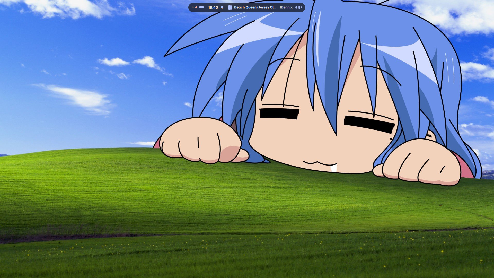
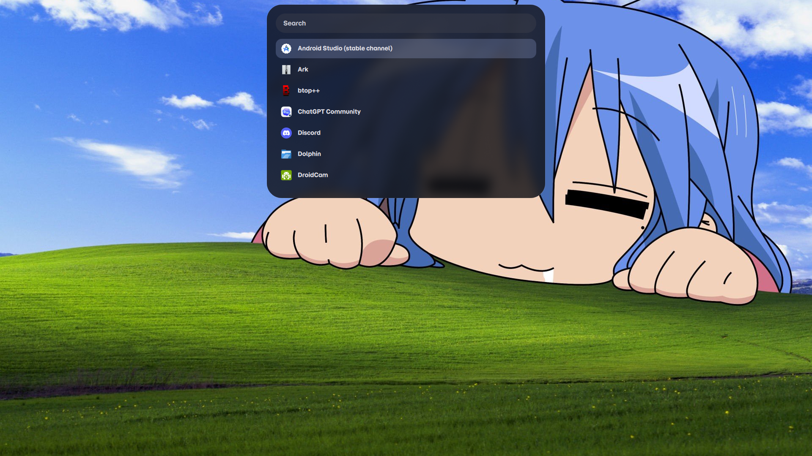
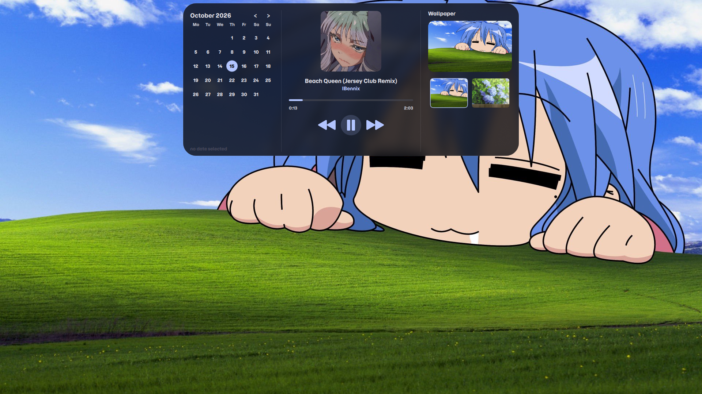
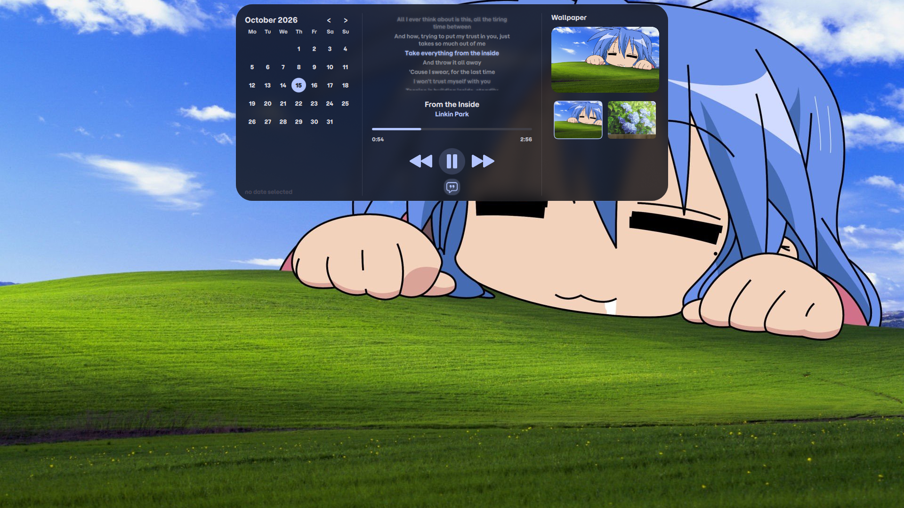
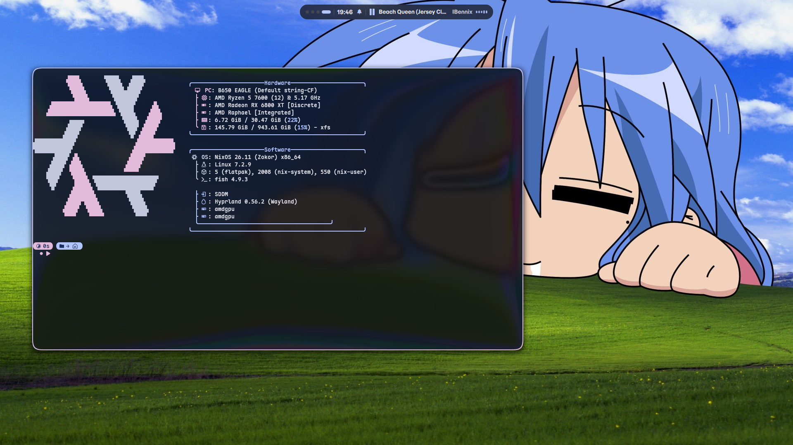
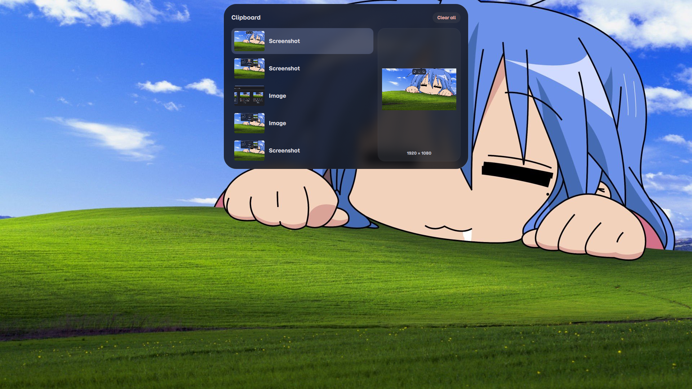
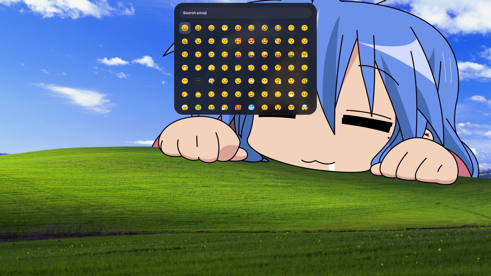
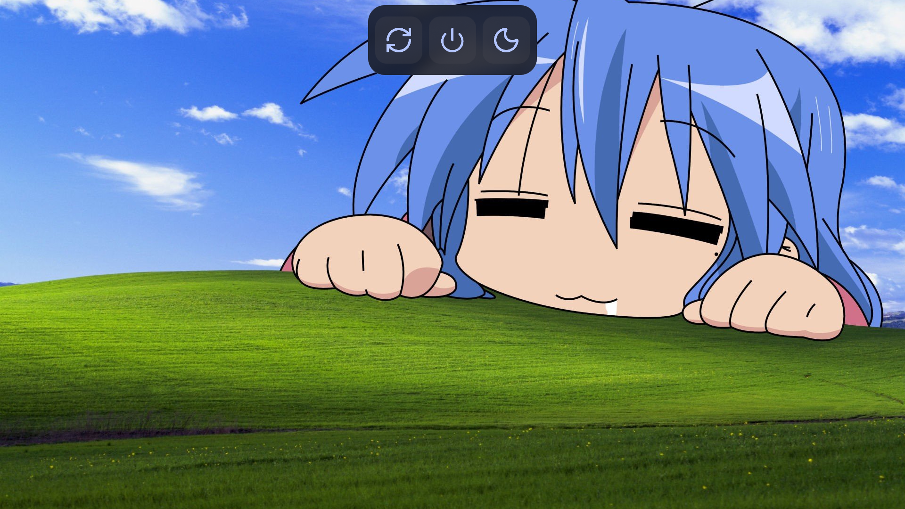

<div align="center">

# 🌸🍙🌸 Moxi's Dots 🌸🍙🌸
**An beautiful Quickshell rice i crafted** <br>
it uses **Quickshell** + **Hyprland** also **awww**, **Hyprlock** for it's main features and components


### Installation

</div>

```
nix-shell -p stow git wget aria2
cd ~/nixos-dots/
bash ./installer
```

<div align="center">

for restoring ur old setup use `-h, --help` flag it'll tell u what to do

### Showcase

**Full Showcase via this Youtube link:**  https://youtu.be/L3jM4u6-SnM

### Screenshots
  
| Blank Workspace |
|:---:|
|  |
  
</div>

| App Launcher | Panel | Lyrics |
|:---:|:---:|:---:|
|  |  |  |

| Terminal | Clipboard | Emoji Picker |
|:---:|:---:|:---:|
|  |  |  |

| Logout |
|:---:|
|  |

