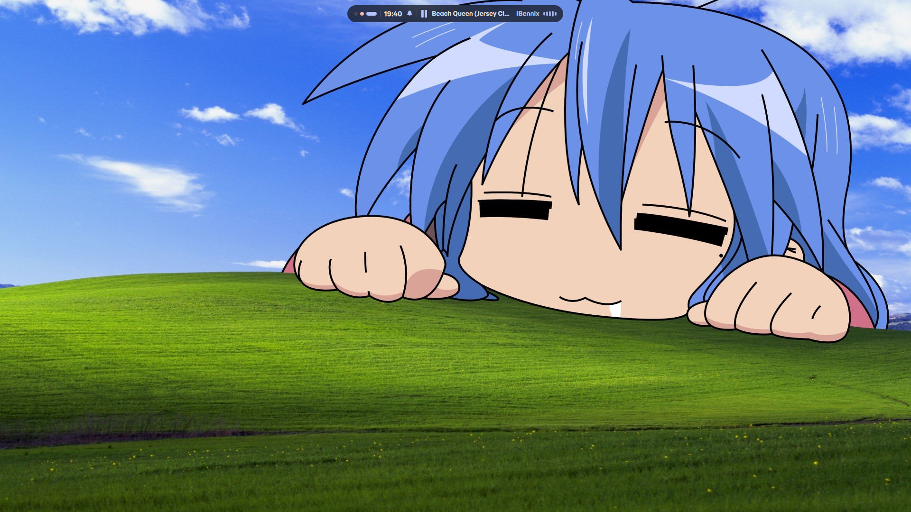
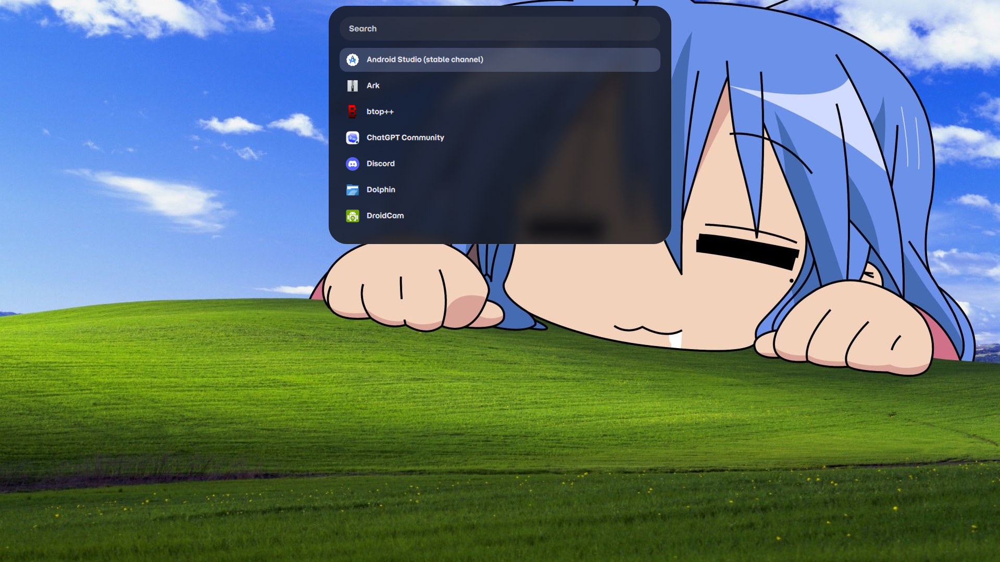
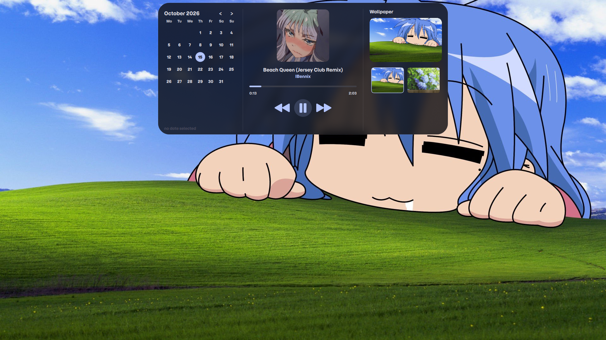
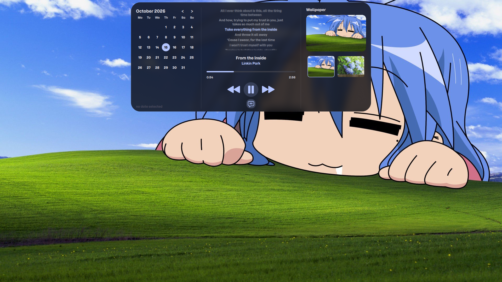
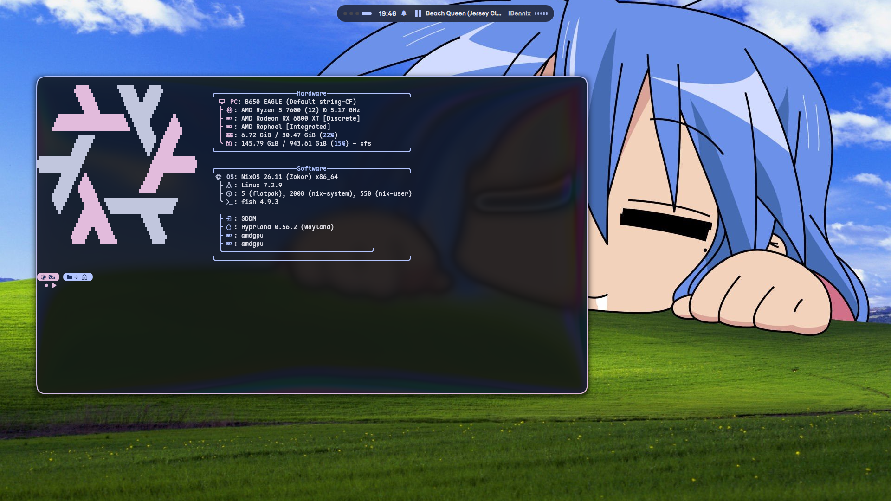
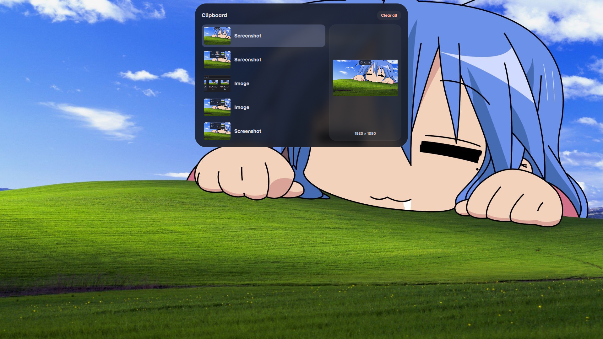
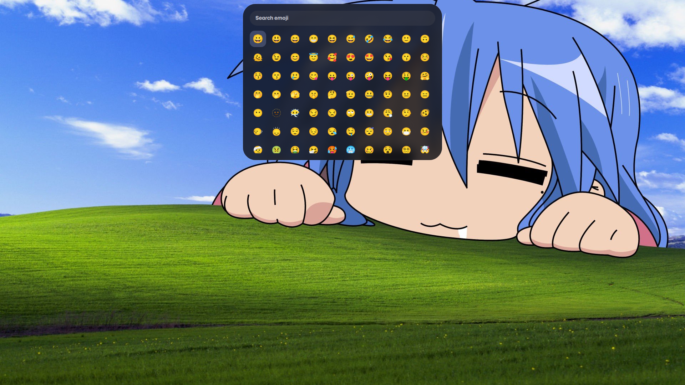
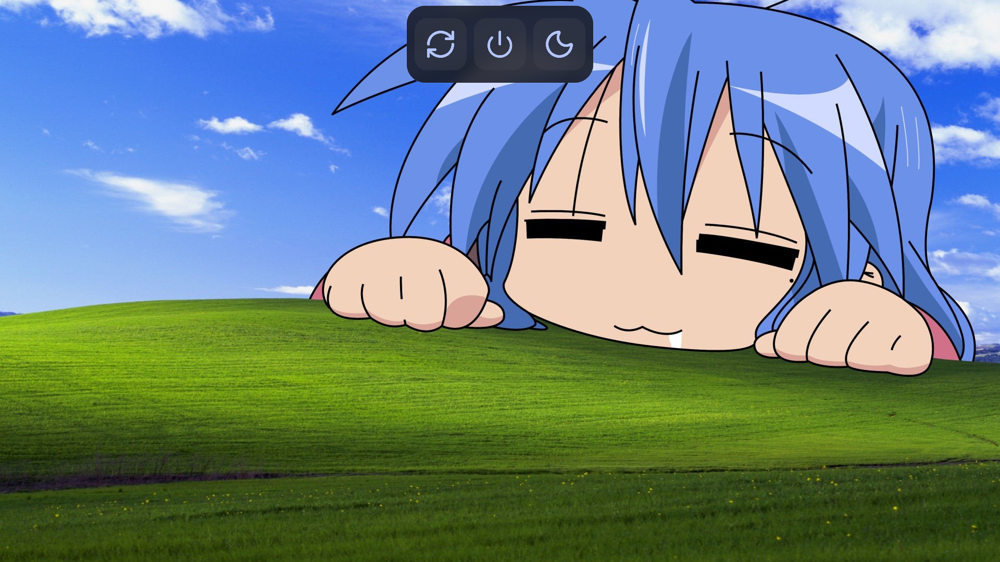

<div align="center">

# 🌸🍙🌸 Moxi's Dots 🌸🍙🌸
**An beautiful Quickshell rice i crafted** <br>
it uses **Quickshell** + **Hyprland**, **Hyprlock** for it's main features and components


### Installation

</div>

```
nix-shell -p stow git wget aria2
cd ~
git clone https://github.com/cfels/nixos-dots.git --recurse-submodules
cd ~/nixos-dots/
bash ./installer
```

Secure boot for ppl with fresh install:

```sh
bash ./installer --secure-boot
```

existing installs can use: `sudo grub-secure-setup`.

<div align="center">

for restoring ur old setup use `-h, --help` flag it'll tell u what to do

### Showcase

**Full Showcase via this Youtube link:**  https://youtu.be/L3jM4u6-SnM

### Screenshots
  
| Blank Workspace |
|:---:|
|  |
  
</div>

| App Launcher | Panel | Lyrics |
|:---:|:---:|:---:|
|  |  |  |

| Terminal | Clipboard | Emoji Picker |
|:---:|:---:|:---:|
|  |  |  |

| Logout |
|:---:|
|  |


Velina animated wallpaper: [PremiumWalls setup and controls](Configs/config/.config/quickshell/moxi/wallpaper/README.md).
